# Hawk — Personal Knowledge Vault

### Architecture and technical approach: source material for the project report

> **What this document is.** A complete technical description of the Hawk
> project (working name *Knowra*), written so it can be turned into a formal
> project report. Every number, constant and design decision below comes from
> the actual source code, not from a plan. Section 18 maps these sections onto
> the chapters a standard college project report expects.
>
> **Diagrams.** The 13 figures are in `diagrams/`: a PNG of each (2× resolution,
> ready to paste into Word or Google Docs) and an SVG (sharp at any zoom in a
> browser). Each one is followed by a short "how to read it" note. They are
> drawn in Mermaid; the editable sources are in `diagrams/src/`. Paste one into
> https://mermaid.live to change it and export it again.

---

## Contents

1. [Abstract](#1-abstract)
2. [Problem statement and motivation](#2-problem-statement-and-motivation)
3. [Objectives](#3-objectives)
4. [Product overview: what the user can do](#4-product-overview-what-the-user-can-do)
5. [Technology stack](#5-technology-stack)
6. [High-level system architecture](#6-high-level-system-architecture)
7. [Data model](#7-data-model)
8. [The ingestion pipeline (capture → searchable)](#8-the-ingestion-pipeline-capture--searchable)
9. [Search and retrieval (the core algorithm)](#9-search-and-retrieval-the-core-algorithm)
10. [Answer generation with enforced citations (RAG)](#10-answer-generation-with-enforced-citations-rag)
11. [The on-device vector index](#11-the-on-device-vector-index)
12. [Authentication and security](#12-authentication-and-security)
13. [Storage connectors (Google Drive and the phone)](#13-storage-connectors-google-drive-and-the-phone)
14. [Plans, metering, billing and retention](#14-plans-metering-billing-and-retention)
15. [Mobile app architecture (Flutter)](#15-mobile-app-architecture-flutter)
16. [Landing website](#16-landing-website)
17. [Performance, cost and testing](#17-performance-cost-and-testing)
18. [Challenges faced and how they were solved](#18-challenges-faced-and-how-they-were-solved)
19. [Limitations and future work](#19-limitations-and-future-work)
20. [Conclusion](#20-conclusion)
21. [Suggested report chapter mapping](#21-suggested-report-chapter-mapping)
22. [Glossary](#22-glossary)
23. [References](#23-references)
24. [Appendix: key numbers at a glance](#24-appendix-key-numbers-at-a-glance)

---

## 1. Abstract

Hawk is a cross-platform mobile application (Android and iOS) that works as a
**personal memory**. Users save screenshots, photos, PDFs, documents, web
links, voice notes and typed notes. Later they can find them by asking in
everyday language ("the electricity bill from July", "what did the landlord
say about the deposit?"). Hawk answers with a short response, and **every
claim in it is linked to the exact file it came from**.

The system is built on a **serverless architecture**: a Flutter client,
Google Firebase (Firestore database, Cloud Storage, Authentication) and around
forty Python Cloud Functions. Each capture goes through a **multimodal
ingestion pipeline** that uses Google Gemini models to read it: transcription
for documents, a visual description plus OCR for photos. The text is split
into overlapping passages ("chunks") and converted into 1536-dimension
embedding vectors.

Retrieval is **hybrid**. A vector nearest-neighbour search over-fetches
candidates, a keyword re-scoring pass ranks them again, and **Reciprocal Rank
Fusion** merges the two rankings. A rule-based query parser pulls out date and
file-type filters. To protect privacy and reduce cost, **the vector index
lives on the user's phone**: the cloud stores only passage text. When the user
asks a question, the phone does the search and sends the server only the IDs
of the passages it chose. The server generates an answer from those passages
and **checks every citation in code**, dropping any claim that cites a source
that does not exist.

Other parts of the system: passwordless sign-in (Google, Apple and email
one-time codes), a Google Drive connector secured with server-held PKCE and
encrypted tokens, and a subscription model with a transactional
**rolling-window answer meter**. Retention demotes old memories instead of
deleting them.

---

## 2. Problem statement and motivation

People save a lot of information they never find again: screenshots of
tickets, PDFs of bills, photos of whiteboards, links to articles, voice
reminders. It ends up spread across the camera roll, downloads, chat apps and
cloud drives. Existing tools fall short in three ways:

| Existing approach | Why it fails |
| --- | --- |
| Folder / file-name search | You must remember *what you called it* and *where you put it*. Photos and screenshots have meaningless names (`IMG_4821.jpg`). |
| Gallery / cloud-drive search | Keyword-based. It can't answer "what was the total on that invoice?" and doesn't read the inside of most files. |
| General AI chatbots | They answer from their training data, not your files, and can **invent** facts with confidence. Uploading documents one conversation at a time doesn't build a lasting memory. |

**The gap:** a system that (a) reads *everything* you save, whatever the
format, (b) lets you find it by meaning rather than by name, and (c) answers
questions **only** from your own files, with proof.

---

## 3. Objectives

1. **Universal capture.** Accept text, notes, links, PDFs, documents,
   screenshots, photos, audio and voice notes from the camera, file picker,
   document scanner, share sheet and voice.
2. **Understanding, not just storage.** Turn every capture into searchable
   text automatically, including pictures that contain no text.
3. **Natural-language retrieval.** Find content by meaning, time ("last
   month", "27 Sep") and type ("the PDF about…").
4. **Grounded answers.** Answer questions only from the user's own files, with
   a citation on every claim, and say "not found" instead of guessing.
5. **Privacy by design.** Strict multi-tenant isolation, no plaintext secrets,
   and search vectors kept on the device.
6. **Bring your own storage.** Connect Google Drive and index chosen folders
   without copying the whole drive.
7. **Sustainable operation.** Keep each user's server cost below plan revenue
   through metering, quotas and model selection.

---

## 4. Product overview: what the user can do

| Feature | What happens |
| --- | --- |
| **Capture** | Photo, document scan, file, link, typed note or voice note. Uploads are de-duplicated by SHA-256 content hash, and uploads pause and resume while offline. |
| **Automatic reading** | Each capture is read by an AI model in the background. A progress screen shows the stages. |
| **Library** | Every memory with type filters, status, and an in-app viewer for the original file. |
| **Search** | Type or speak a query. Matching files appear with a relevance score. |
| **Ask** | Ask a question. The answer is a few short paragraphs, each with numbered citations that open the source file. Follow-up questions keep conversational context. |
| **Voice home** | An animated "eye orb" home screen: hold or tap to speak, with on-device speech recognition. Results are fetched in advance while the user is still speaking. |
| **Connect Google Drive** | Choose folders or individual files to index. A scheduled job keeps them in sync. |
| **Plans** | Free, Standard ($4.99/month) and Premium ($9.99/month), bought through Google Play / App Store in-app purchase. |
| **Account** | Profile, deactivate, delete account (with a public web page for store compliance). |

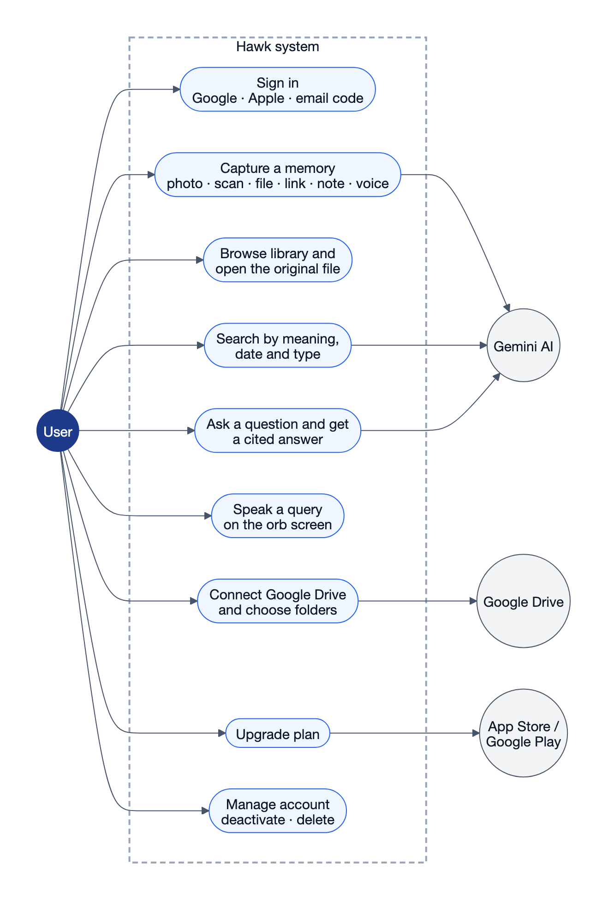

*Figure 1: Use-case diagram.*

**How to read it.** The User actor on the left takes part in nine use cases
inside the dashed system boundary. Three external systems on the right take
part in some of them. Gemini reads captures, writes answers, and turns a
search question into a vector (the ranking itself runs on the phone). Google
Drive supplies connected files, and the stores handle payment.

---

## 5. Technology stack

| Layer | Technology | Why it was chosen |
| --- | --- | --- |
| Mobile client | **Flutter (Dart)** | One codebase for Android and iOS, fast custom UI, GPU shaders for the orb |
| State management | **BLoC / Cubit** (`flutter_bloc`) | Predictable one-way state flow, easy to unit test (`bloc_test`) |
| Dependency injection | **get_it + injectable** | Generated composition root; swap implementations for tests |
| Navigation | **go_router** | Declarative routes, deep links, a tab shell with nested routes |
| Models | **freezed + json_serializable** | Immutable data classes, generated `copyWith`, equality, JSON |
| Error / crash logging | **Sentry** | Crash and error reports from production devices |
| Database | **Cloud Firestore** | Real-time listeners, security rules, built-in vector (KNN) search |
| File storage | **Firebase Cloud Storage** | Uploads of original files, protected by per-user rules |
| Authentication | **Firebase Auth** + custom email OTP | Google / Apple sign-in, plus a six-digit email code |
| Backend logic | **Cloud Functions for Firebase (Python 3.12)** | Serverless: no server to run, scales to zero, triggers on DB writes |
| AI models | **Google Gemini** (embedding + Flash / Flash-Lite) | One multimodal model for OCR, PDF reading, picture description and answers |
| Payments | `in_app_purchase` + Google Play / App Store server APIs | Store-verified subscriptions |
| Speech | `speech_to_text` (on-device recogniser) | Voice queries with no audio upload |
| Website | **Vite + React 19 + TypeScript**, prerendered, on **Vercel** | Fast static landing page, SEO, legal pages |
| Backend tooling | `pytest`, `ruff`, `uv` | Tests, linting, dependency management |
| App tooling | `flutter analyze`, `flutter test`, golden image tests, `mocktail` | Static analysis, unit / widget / visual regression tests |

**Codebase size (hand-written code, excluding generated files):**

| Part | Size |
| --- | --- |
| Flutter app | ~190 Dart source files, ~39,000 lines |
| Cloud Functions | ~10,200 lines of Python (production) + 19 test modules |
| Automated tests | ~790 Flutter test cases in 100 files, 29 golden images; ~350 Python tests |

---

## 6. High-level system architecture

### 6.1 Context and architecture diagrams

**Context diagram (DFD level 0).**

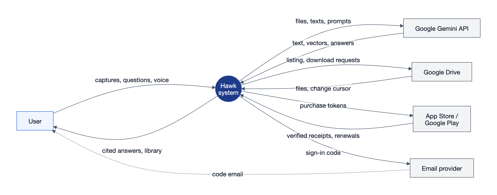

*Figure 2: Context diagram (DFD level 0).*

**How to read it.** The whole system is the single dark circle, and every
arrow is data crossing the system boundary. Read each external entity as a
pair of arrows: what Hawk sends out, and what comes back. The dotted arrow is
the one flow that bypasses Hawk: the sign-in code travels from the email
provider to the user's inbox, and the user types it back into the app.

**System architecture.**

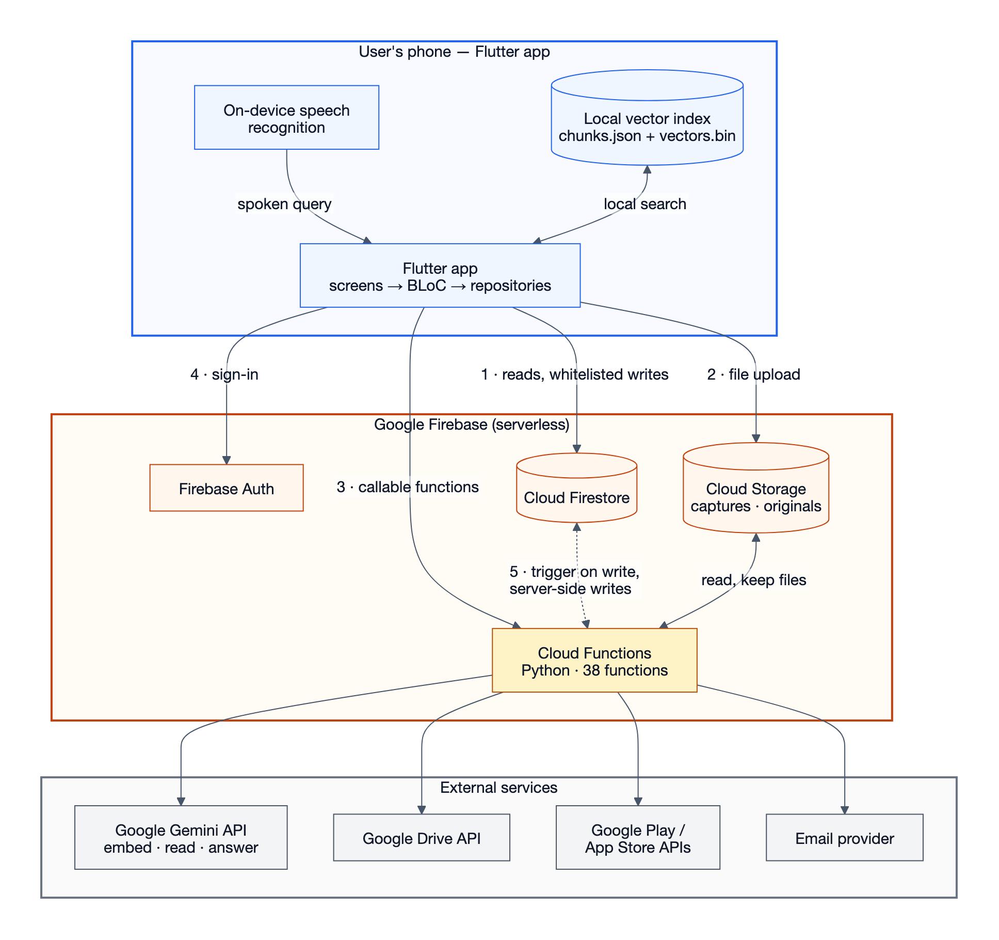

*Figure 3: System architecture.*

**How to read it.** Read it top to bottom in three bands: the phone (blue),
Google Firebase (orange) and third-party services (grey). Arrows 1–4 are the
**only** four ways the app talks to the cloud:

- **1** The app reads its own data straight from Firestore and may write only
  a few whitelisted fields. The security rules decide what is allowed.
- **2** File bytes go straight to Cloud Storage.
- **3** Anything involving money, quotas, secrets or AI goes through a Cloud
  Function the app calls by name.
- **4** Sign-in.

Arrow **5** (dotted) is the key idea: the app never calls a "process this
file" endpoint. It **writes a document**, and the write itself **triggers**
the pipeline. The functions then write their results back. Inside the phone
band, the local vector index sits next to the app, because search runs on the
device (Section 11). Everything in the grey band is reached only by server
code that holds the secret keys.

### 6.2 The central design principle: "no server to run"

There is no always-on backend server. Instead:

| Concern | Traditional backend | Hawk |
| --- | --- | --- |
| Reading the user's data | `GET /memories` REST endpoint | App listens to Firestore directly (real-time) |
| Multi-tenant safety | `WHERE user_id = ?` in every query | **Security rules** enforced by the database itself |
| Starting a background job | Enqueue on a message queue | Write a document → **Firestore trigger** runs the function |
| Progress updates | Polling endpoint / WebSocket | App streams the job document; the worker updates it |
| Secrets and money | Server code | **Callable Cloud Functions**, the only code holding API keys |

Cloud Functions exist **only** where the client cannot be trusted or cannot do
the work: anything that spends money or quota, writes server-owned state, or
needs a secret key.

**Design evolution worth mentioning in the report.** The original written
specification proposed PostgreSQL + pgvector, Redis, object storage and a
Python API server. The implementation moved to Firebase instead. The security
rules file itself records the reasoning: in a SQL backend, *forgetting* the
`user_id` clause leaks another user's rows. With database-enforced rules,
forgetting it gets the read **denied**. That is a safer failure mode.

### 6.3 Repository layout

```
knowra/
├── app/                  Flutter client (Android + iOS)
│   ├── lib/src/app/        router, theme, app shell
│   ├── lib/src/core/       DI, logging, cache, errors, shared widgets, feedback
│   ├── lib/src/features/   auth · account · billing · capture · chat ·
│   │                       connectors · memory · splash · voice
│   ├── shaders/            eye_orb.frag (GPU fragment shader for the orb)
│   └── test/               unit, widget and golden tests
├── firebase/
│   ├── firestore.rules     multi-tenant security rules (the enforced contract)
│   ├── storage.rules       file upload rules
│   ├── firestore.indexes.json   composite + vector indexes
│   └── functions/          all backend Python (one module per concern)
├── frontend/             landing website (Vite + React + TypeScript)
├── design/               UI design handoffs, Blender motion assets
└── docs/                 setup, connectors, pricing, QA documents
```

### 6.4 Backend module map (`firebase/functions/`)

| Module | Responsibility |
| --- | --- |
| `main.py` | Manifest: exports every deployable function (38 in total) |
| `ingestion.py` | Firestore trigger: capture → extracted → chunked → ready |
| `extraction.py` | Picks a reading route for each memory type |
| `link_archive.py` | Safely fetches and cleans web pages behind saved links |
| `gemini.py` | The **only** module that talks to an AI model (embed, read, answer) |
| `chunking.py` | Splits text into overlapping, sentence-aware passages |
| `query_understanding.py` | Rule-based parser for dates, types and filler words in queries |
| `retrieval.py` | Hybrid retrieval: vector over-fetch → lexical rescore → RRF |
| `rag.py` | Answer generation and **citation enforcement** |
| `local_index.py` | Server side of on-device search (embed calls, passages by ID) |
| `chunk_store.py` | Chunk writes, soft deletes (tombstones), daily sweep |
| `api.py` | Callables: `search`, `ask`, `embed_texts`, `get_subscription`… |
| `usage.py` | Answer meter: rolling 2-hour window + weekly cap (transactional) |
| `billing.py`, `products.py` | Plan table (entitlements), product catalogue |
| `billing_api.py`, `subscriptions.py` | Store receipt verification, renewal notifications |
| `retention.py` | Moves expired memories to *dormant* and revives them on upgrade |
| `index_budget.py` | Per-user index size accounting and partial indexing |
| `file_vault.py` | Keeps original files within the plan quota; deletes them with the memory |
| `email_codes.py` | Six-digit email sign-in → Firebase custom token |
| `connector_*.py`, `connectors/` | Google Drive OAuth, folder selection, sync jobs |
| `device_vault.py` | The phone itself as a storage source |
| `reindex.py` | Re-reads failed / backlog memories every 6 hours |
| `meta_cache.py` | 2-minute in-memory cache of memory metadata for search |
| `account_api.py`, `user_lifecycle.py` | Profile creation, deactivate / delete account |

---

## 7. Data model

### 7.1 Firestore collections

| Collection | Contents | Client access |
| --- | --- | --- |
| `users/{uid}` | Profile: name, input preference (voice / typing), onboarding flags | Read own; update **only** `name`, `inputPreference`, `onboardedAt`, `updatedAt` |
| `users/{uid}/subscription` | Current plan and entitlements | Read only (written by server) |
| `users/{uid}/usage` | Answer-meter ledger | Read only |
| `users/{uid}/receipts` | Purchase history from the stores | Read only |
| `memories/{id}` | One captured item: type, title, status, storage path, content hash, recall state, chunk count, index note | Create (status must be `uploaded`); update title / access stats only; delete |
| `chunks/{id}` | One passage: text, memory ID, position, recall state, `updatedAt`, (legacy) embedding | Read only |
| `conversations/{id}/messages` | Chat history with answers and citations | Read; messages are **server-written only** |
| `storageAccounts/{id}` | Connected Drive / phone vault, folder selection, sync status | Read only; `private/` sub-collection (tokens) denied to **everyone** |
| `indexJobs/{id}` | Progress of a connector's first indexing run | Read only (streamed by the progress screen) |
| `emailChallenges`, `oauthChallenges`, `storeSubscriptions`, `testAccounts` | Server secrets and mappings | **No client access at all** |
| *anything else* | — | Denied by default (`match /{document=**}`) |

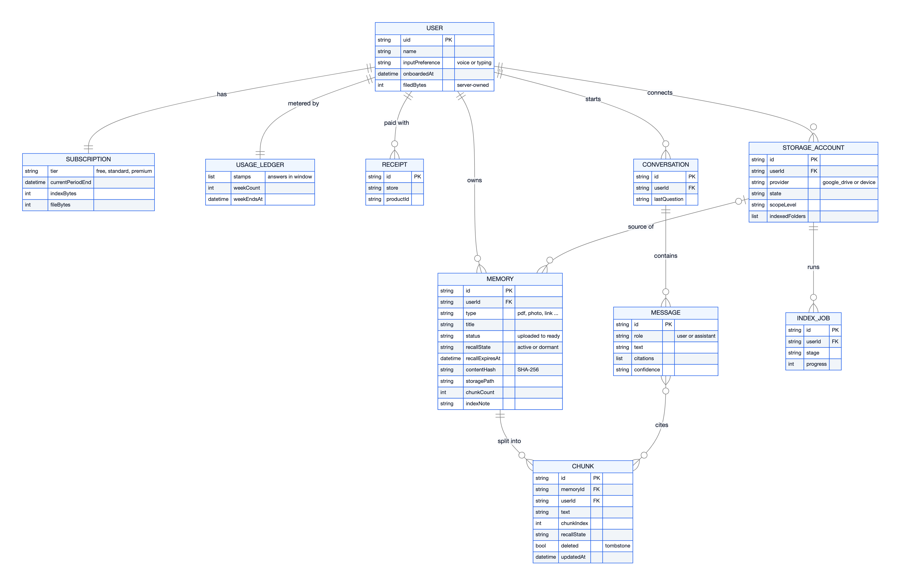

*Figure 4: Entity-relationship diagram.*

**How to read it.** The lines use crow's-foot notation: a double bar means
"exactly one", and a circle with a fork means "zero or more". USER is the root,
and every other entity carries a `userId`, which is what the security rules
check. The central chain is USER → MEMORY → CHUNK: one memory is split into
many chunks, and chunks are what a MESSAGE's citations point to. Firestore is a
document database, so these "tables" are collections (SUBSCRIPTION,
USAGE_LEDGER and RECEIPT are sub-collections under the user). The relationships
are stored IDs, not foreign-key constraints: the rules and Cloud Functions
enforce them.

### 7.2 "A memory is not a file"

A **memory** is the *understood* version of something the user saved. Its
original bytes may be kept in Cloud Storage, live on the phone, or sit in the
user's Google Drive. A memory can exist and answer questions even when the
original file could not be kept (for example, over the storage quota), and it
says so in its `indexNote`.

Storage layers:

| Layer | Where | Purpose |
| --- | --- | --- |
| 1. Original data | Phone / Drive / Cloud Storage (`originals/`) | So the user can *open* it again |
| 2. Extracted content | Chunk text in Firestore | So it can be *read* and cited |
| 3. Memory representation | `memories` document | Title, type, dates, status |
| 4. Embeddings | **On the phone** (`vectors.bin`) | So it can be *found* by meaning |

### 7.3 Memory processing state machine

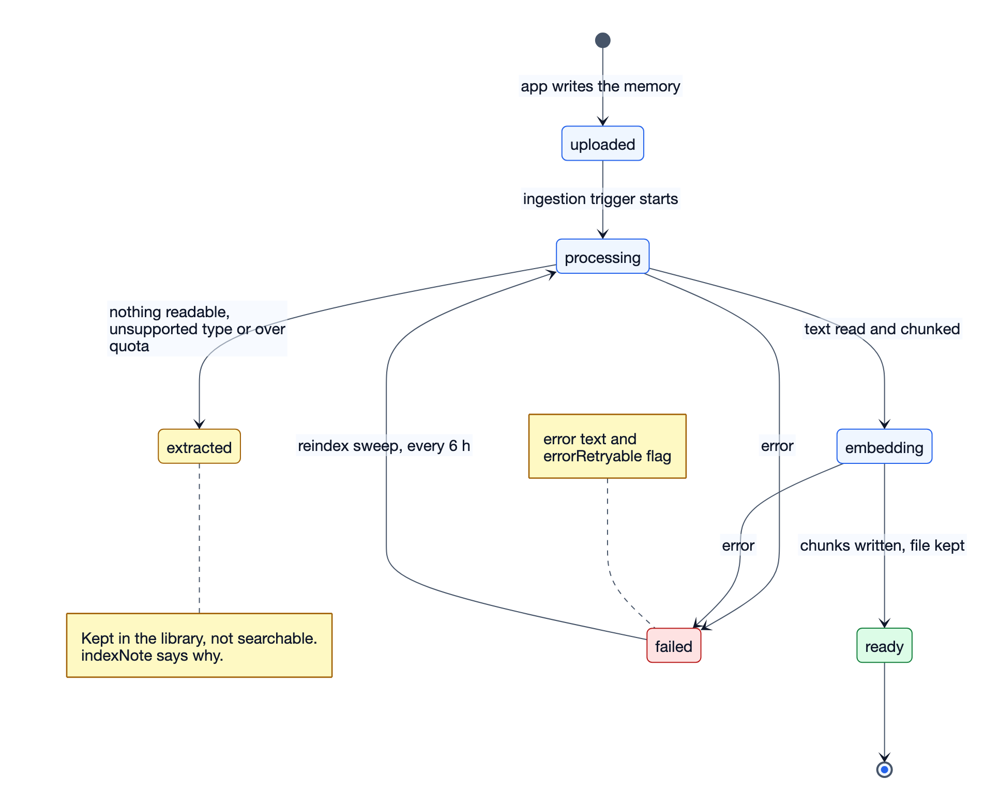

*Figure 5: Memory processing state diagram.*

**How to read it.** Start at the black dot and follow the arrows. The
right-hand path, uploaded → processing → embedding → ready, is the normal life
of a capture. The yellow state on the left is a **deliberate third outcome**:
the software worked, but there was nothing it could index ("Too short to
index", "Nothing readable in this capture"). The memory stays in the library
and is not shown as a failure. The red state is a real failure. Its
`errorRetryable` flag separates "try again later" (a rate limit) from "this is
broken", and the reindex sweep every 6 hours sends retryable failures back to
processing. Three outcomes instead of two means the user always knows *why* a
file can't answer questions.

---

## 8. The ingestion pipeline (capture → searchable)

### 8.1 Flow

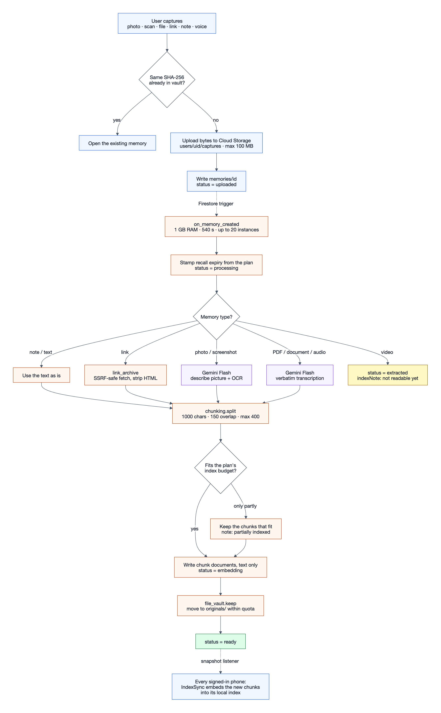

*Figure 6: Ingestion pipeline, from capture to searchable.*

**How to read it.** Read top to bottom. Blue boxes run on the phone, orange
boxes in Cloud Functions, and purple boxes are AI model calls. The phone's work
ends once it has written one document; the dotted "Firestore trigger" arrow is
where the cloud takes over. The fan-out in the middle is the per-type reading
route (8.2). The two diamonds near the bottom are cost controls. The pipeline
never creates vectors: the last dotted arrow hands the new chunks to each
phone, which embeds them itself (Section 11).

### 8.2 Extraction: one multimodal model instead of three engines

Instead of separate OCR, PDF-parsing and speech-to-text engines, one Gemini
multimodal call reads any file:

| Memory type | Route | Prompt style |
| --- | --- | --- |
| Note / text | Already text | — (free, instant) |
| Link | `link_archive` fetches the page and strips scripts, styles and tags | — |
| Photo / screenshot | Gemini (Flash) | **Describe**: "What the picture shows: … / Text in the picture: …" |
| PDF, document, audio | Gemini (Flash) | **Transcribe** verbatim |
| Video | Not yet supported (needs audio-track extraction) | Recorded as `indexNote`, not failure |

**Why pictures are *described*:** an early version only asked the model to
"transcribe" every file. A photo of a garden has no text, so it produced
**zero chunks**, and "garden image" found nothing. Pictures now get a
description prompt, so they can be found by what they show.

**Model reliability:** the reader uses a fallback ladder (primary model →
fallback model → safety net). It retries HTTP 429 and 5xx responses with
back-off (2 s / 5 s / 12 s / 25 s, respecting `Retry-After`). Each memory
records which model read it (`readWith`), so files read by the cheaper
fallback can be re-read later. Free-plan files are read by a cheaper
"economy" model.

### 8.3 Chunking algorithm

The chunk is the unit of retrieval and citation, so its size is a product
decision:

| Constant | Value | Reason |
| --- | --- | --- |
| `TARGET` | 1000 characters (≈250 tokens) | Big enough to keep context, small enough that one vector means one topic |
| `OVERLAP` | 150 characters | A fact on a boundary appears whole in at least one chunk |
| `MIN_CHUNK` | 60 characters | Headings, page numbers and stray lines aren't worth a vector |
| `MAX_CHUNKS` | 400 per memory | One huge document must not crowd every search result |

Steps:

1. **Normalise** whitespace, soft hyphens and zero-width characters *before*
   chunking, so recorded character offsets stay valid.
2. Split on **paragraphs** (blank lines) first. A paragraph break is a
   stronger topic boundary than a sentence end.
3. Split paragraphs into **sentences** with a conservative regex that keeps
   "Inc." and "v4.2" intact.
4. Assemble sentences into chunks near `TARGET`, carrying `OVERLAP` into the
   next chunk.
5. Any unit still too long (for example unpunctuated or non-Latin text such
   as Hindi) is **sliced into overlap-sized pieces**. See challenge 18.5.

Each chunk records its `index` (position, used in citations) and `start`
(character offset, so a viewer could scroll to the passage).

### 8.4 Index budget and partial indexing

Each plan has an index-size allowance. The cost per chunk is estimated as
`len(text) + 1536 × 8 bytes` (the vector is 12.3 KB and dominates). The
budget is checked **before** embedding, because embedding is the part that
costs money. If a user is over budget, whatever fits is indexed and the memory
says "partially indexed". The first pages of a document usually answer most
questions, so partial beats refusing the whole file.

---

## 9. Search and retrieval (the core algorithm)

### 9.1 Query understanding (rule-based, no AI call)

"Find that video about vector databases I watched around July" contains three
signals: **topic** (vector databases), **type** (video) and **time** (July).
Embedding the whole sentence mixes "video" and "July" into the topic vector,
where they add noise. So Hawk parses them out as **filters**:

- **Type** → a *pre-filter* (narrows the candidate set).
- **Date window** → a *post-filter* applied to the over-fetched candidates,
  because Firestore can't combine a range filter with vector search.
- Parsing covers relative dates ("last week", "last 7 days", "last month"), month names, explicit days
  ("27 Sep", "Sep 27th, 2026", ISO, `27/09/2026`), filler trimming ("about",
  "the") and the user's **own time zone**.

**Why not use an AI model for this?** It was tried first and measured:

| Approach | Latency | Reliability |
| --- | --- | --- |
| LLM extraction (Gemini Flash) | 1.5–4.2 s | 1 in 3 calls failed (503 / truncated output) |
| Embedding call (for comparison) | 0.53 s | — |
| **Rule-based parser (final)** | **microseconds** | **cannot fail, costs nothing** |

The LLM version was slower than the search it was supposed to speed up, and
it failed a third of the time. The same parser exists in Python (server) and
Dart (phone) with identical behaviour.

### 9.2 Hybrid retrieval: over-fetch → rescore → fuse

Firestore offers exactly one search primitive: vector KNN. It has no keyword
index and no reranker. Hawk still gets most of the benefit of *hybrid search*
without running a second search engine:

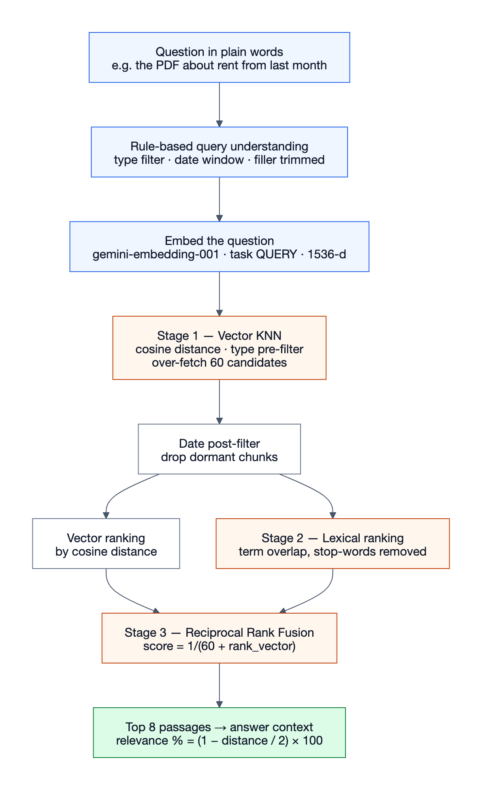

*Figure 7: Hybrid retrieval funnel.*

**How to read it.** Read top to bottom. Blue boxes prepare the question,
orange boxes are the three ranking stages, and green is the output. The
candidate set narrows from *all the user's chunks* to 60, then to 8. Stage 1 is
the only stage that can **find** a passage. Stages 2 and 3 only **reorder** what
stage 1 returned. That is the design's honest limit: a passage the vector
search never returns can't be rescued by keywords.

**Reciprocal Rank Fusion (RRF).** For each passage *d*:

```
RRF(d) = 1 / (k + rank_vector(d))  +  1 / (k + rank_lexical(d)),   k = 60
```

RRF combines **ranks** rather than raw scores. Cosine distance and keyword
counts are on unrelated scales, and any fixed weighting between them would be
a guess. k = 60 is the value from the original RRF paper (Cormack et al.,
2009).

**Relevance shown to the user** comes from cosine distance, not from the fused
score (which only means something inside one result set):
`relevance = round((1 − distance / 2) × 100)`.

### 9.3 Embeddings

| Property | Value |
| --- | --- |
| Model | `gemini-embedding-001` |
| Dimensions | 1536 (Matryoshka truncation of the native 3072) |
| Normalisation | Re-normalised to unit length **after** truncation |
| Task types | `RETRIEVAL_DOCUMENT` for chunks, `RETRIEVAL_QUERY` for questions |

Two subtle points worth explaining in the report:

1. **Asymmetric embedding.** A question and the passage that answers it are
   different kinds of text. Telling the model which is which measurably
   improves recall.
2. **Re-normalisation.** Only the full 3072-d vector is unit length. A
   truncated vector must be re-normalised, or cosine distance is silently
   wrong.

---

## 10. Answer generation with enforced citations (RAG)

### 10.1 The citation contract

The product promise is not "it answers questions". It is **"every answer comes
back with the file it came from."** The prompt asks for this, but the
guarantee comes from **code that checks the model's output afterwards**.
Three rules live in `rag.py`:

| Rule | Implementation | Why |
| --- | --- | --- |
| **Invented citations are dropped** | Every answer block's citation numbers are checked against the passages actually supplied. A block whose citations are *all* invalid is removed. | Models invent citation numbers to look thorough. |
| **No passages → no model call** | With nothing retrieved, the model is never asked. The user gets "Nothing in your vault matches that yet." | A model with empty context answers from general knowledge, sounds just as confident, and is wrong about *your* life. |
| **Confidence is derived, not self-reported** | The model's "high / medium / low" is capped by retrieval quality. If the best passage's cosine distance is > 0.62, or nothing was cited, confidence is forced to "low". A single cited source can't be "high" (one source isn't corroboration). | A model can't know its best passage was a weak match. |

The model must return strict JSON:

```json
{
  "blocks": [{ "text": "A claim or two.", "citations": [1, 2] }],
  "confidence": "high | medium | low",
  "answered": true
}
```

### 10.2 End-to-end "ask" sequence

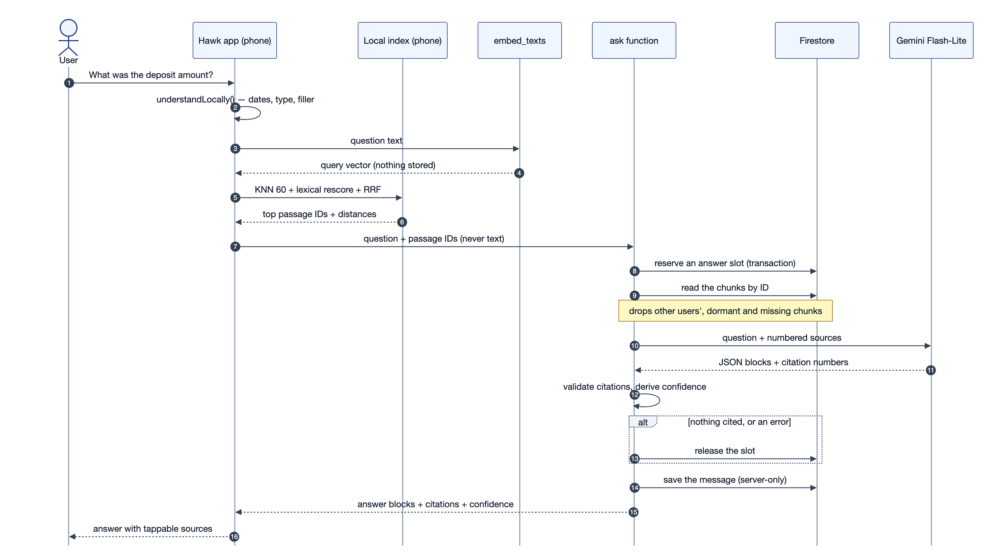

*Figure 8: Sequence diagram for asking a question.*

**How to read it.** Each vertical line is a participant. Time runs downward,
and the numbered circles give the order. Steps 1–6 run **on the phone**,
including the search itself. At step 7 the phone sends passage **IDs, never
text**. Steps 8–9 are the security boundary: the server re-reads each passage
and discards anything that isn't the caller's own recallable chunk. A modified
app can therefore *choose* among the user's passages but can never *inject*
text into the model's context. The `alt` box (step 13) is the refund path: an
answer that cited nothing doesn't count against the plan.

**Fallback:** until the phone's index is ready (first minutes after install,
or on a second device), both search and ask fall back to the server-side
retrieval path.

---

## 11. The on-device vector index

### 11.1 The decision

**The cloud keeps passage text and metadata. Each phone keeps the vectors and
does the retrieval.**

| Benefit | Explanation |
| --- | --- |
| Privacy | The numeric fingerprint of every passage is stored only on the user's own device. |
| Cost | Search runs on the phone, so it is **never metered**. Only AI answers count against the plan. |
| Latency | No server round-trip for ranking. Only the question's embedding needs the network. |
| Smaller cloud footprint | 1536 doubles per chunk (12 KB) no longer sit in Firestore. The phone stores Float32 (6 KB per chunk). |

| Cost of the decision | Mitigation |
| --- | --- |
| Each device must build its own index | Batched embedding (50 texts per call), progress snackbar on first build |
| Index not ready right after install | Automatic fallback to server retrieval |
| Deletions while the phone was offline | Periodic full reconcile against the server's complete ID set |
| Changing the embedding model | Per-device rebuild. The `Embedder` interface already isolates this. |

### 11.2 Sync design

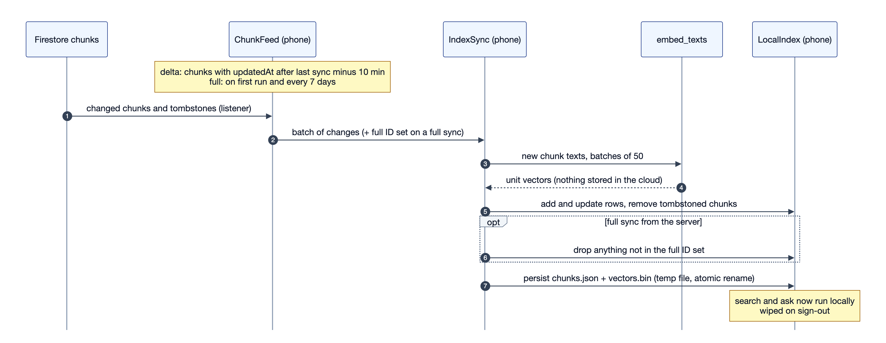

*Figure 9: On-device index sync.*

**How to read it.** Time runs downward. Step 1 is a Firestore listener. In
delta mode it receives only the chunks changed since the last sync (the note at
the top). Steps 3–4 are the only place text becomes vectors: `embed_texts`
returns them and **stores nothing**. The `opt` box (step 6) runs only on a full
sync. A listener can't report an absence, so the complete ID set is how the
phone learns about deletions it missed while offline. Step 7 writes to a
temporary file and renames it, so a crash mid-write can't corrupt the index.

Key techniques:

- **Delta sync.** Each chunk carries a server timestamp `updatedAt`. The phone
  remembers its last sync time and asks only for later changes. A 10-minute
  safety overlap covers clock skew.
- **Soft deletes (tombstones).** Deleting a memory marks its chunks
  `deleted: true` with empty text instead of removing them, so a delta
  listener *sees* the deletion. A daily job hard-deletes tombstones older than
  30 days.
- **Reconcile.** A listener can't report an absence. The first full server
  snapshot (not the offline cache) supplies the complete ID set, and anything
  the phone holds that isn't in it is dropped.
- **Atomic persistence.** Files are written to a temporary path and renamed,
  so a crash mid-write never leaves a corrupt index.
- **Identical ranking.** `ranking.dart` is a port of the server's
  `retrieval.py` with the same constants (60 / 8 / k = 60), so phone and
  server rank the same way.

---

## 12. Authentication and security

### 12.1 Sign-in methods

| Method | How |
| --- | --- |
| Google | `google_sign_in` → Firebase Auth credential |
| Apple | `sign_in_with_apple` → Firebase Auth credential |
| Email (6-digit code) | Custom flow on Cloud Functions → Firebase **custom token** |

Firebase Auth has magic links but no email OTP. Magic links work badly on
mobile: they bounce through a mail app and a browser, and they break when
opened in a different browser. So the one-time code is implemented on the
server:

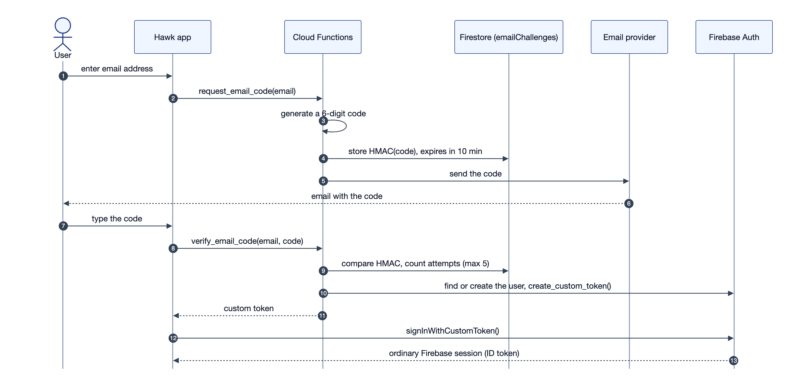

*Figure 10: Sequence diagram for email-code sign-in.*

**How to read it.** Time runs downward. Steps 1–6 request a code, and steps
7–13 redeem it. The code itself is never stored, only its HMAC (step 4). The
last two steps are the point of the design: the client ends up with an
**ordinary** Firebase session, so the security rules and every other function
never need to know a custom flow was used.

Limits: code valid for 10 minutes, 60-second resend cooldown, 5 wrong
attempts, 5 codes per hour. The challenge collection is unreadable by any
client.

### 12.2 Security measures (a table for the report)

| Threat | Defence |
| --- | --- |
| User A reads user B's data | Firestore rules: every read requires `request.auth.uid == resource.data.userId`. Unknown collections are denied by default. |
| Client grants itself Premium / edits quotas | Plan, usage, receipts and file-byte counters are **server-owned**. Rules deny all client writes. Profile writes are limited to 4 whitelisted fields. |
| Client marks an unprocessed memory as "ready" | Create rule requires `status == 'uploaded'` and `recallState == 'active'` |
| Poisoned search index | Chunks (text and vectors) are read-only to clients |
| Forged AI answers / citations | Conversation messages are written only by the `ask` function |
| Prompt injection via crafted passages | The phone sends passage **IDs**. The server reads the text itself and filters by owner. |
| Oversized or dangerous uploads | Storage rules: owner-only path, < 100 MB, allowed MIME types only |
| **SSRF** through saved links (fetching `169.254.169.254`, the cloud metadata server) | Scheme allow-list (http/https only), private / loopback / link-local IPs refused, **every redirect hop re-checked by hand** (max 5), body capped at 2 MB, 10 s timeout |
| Stolen OAuth redirect (malicious app on the same URL scheme) | **PKCE verifier stays on the server**. The app only ever has a challenge ID. |
| Leaked Google Drive refresh token | Tokens **encrypted with AES-GCM** (`CONNECTOR_KEY`) and stored in a `private/` sub-collection denied to *every* client, including the owner |
| Brute-forcing email codes | HMAC-stored codes, attempt limits, rate limits, short expiry |
| Fake purchase receipts | The client sends only a purchase token. Tier and expiry come from Google Play / Apple **server APIs**. With credentials missing, verification refuses rather than trusting the client. |
| Time-zone trick to reset the weekly quota | `weekEndsAt` is recorded when the week's first answer is taken and never recomputed |
| Two parallel requests both taking the last answer slot | Firestore **transaction** reserves the slot before the model runs |

**Known and documented gap:** DNS rebinding in link fetching. A hostname that
resolves to a public IP during the check and a private IP during the fetch is
not fully closed. Closing it needs connection pinning in a custom HTTP
transport. This is written up in the source code as a known limitation.

---

## 13. Storage connectors (Google Drive and the phone)

### 13.1 Connector contract

The rest of the backend talks to a generic `StorageConnector` interface.
Only modules under `connectors/` know Drive-specific details (for example,
that Drive treats a folder as "a file with a folder MIME type"). Provider
differences are declared **as data** on a `ProviderProfile`, not as
`if provider == …` branches. Adding a provider means adding a module, not
editing five call sites. Google Drive is currently the only provider.

### 13.2 OAuth with server-held PKCE

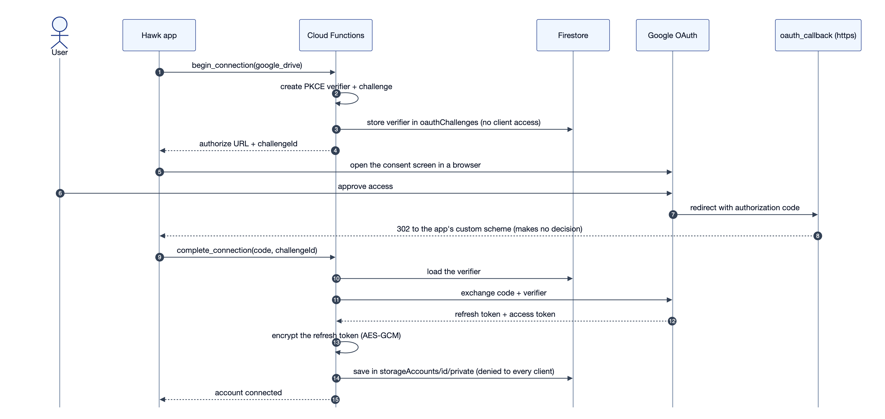

*Figure 11: Sequence diagram for connecting Google Drive (OAuth with PKCE).*

**How to read it.** Time runs downward. Step 2 creates the PKCE pair, and
step 3 keeps the verifier on the server; the app only ever holds a
`challengeId`. Google won't redirect to a custom app scheme for restricted
scopes such as Drive read access, so the redirect lands on a public HTTPS
function, `oauth_callback` (steps 7–8). It deliberately makes no decisions and
only forwards the code to the app. An attacker who intercepts that code still
lacks the verifier (steps 10–11). Steps 13–14 encrypt the refresh token and
store it where no client can read it.

**Minimum permissions:** scope levels are requested step by step (basic
connection first, broader access only when needed).

### 13.3 Indexing and sync

- The user chooses folders or individual files. `on_index_job_created`
  enumerates them, de-duplicates, and writes one `memories` document per file.
  The **existing ingestion trigger** then processes each one, so the connector
  never duplicates pipeline logic.
- Progress is written to an `indexJobs` document that the app streams live
  (no polling).
- `sync_connected_accounts` runs **every 6 hours**. It asks Drive what changed
  since a stored cursor and reconciles.

### 13.4 The phone as a source ("device vault")

The phone itself is offered as a storage source alongside Drive. It is stored
as a row in `storageAccounts` so onboarding and settings treat it like any
source, but it **never uses a paid plan's account slot**. Charging a free
user's only slot for their own phone would be hostile.

---

## 14. Plans, metering, billing and retention

### 14.1 Plan table (`billing.py`)

| | Free | Standard | Premium |
| --- | --- | --- | --- |
| Price | — | **$4.99 / month** | **$9.99 / month** |
| Memory window (searchable) | 30 days | 1 year | Unlimited |
| Connected cloud accounts | 1 | 3 | All |
| Index allowance | 2 GiB | 32 GiB | 256 GiB |
| Kept original files | 1 GiB | 30 GiB | 200 GiB |
| AI answers per 2-hour window | 2 | 10 | 25 |
| AI answers per week | 20 | 150 | 400 |
| Search | Unlimited (on device) | Unlimited | Unlimited |

### 14.2 Answer metering: rolling window + weekly cap

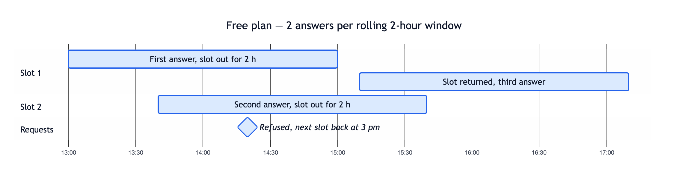

*Figure 12: Rolling answer window on the Free plan.*

**How to read it.** Time runs left to right. Each bar is one answer slot
being "out" for exactly 2 hours from the moment it was used. On the Free plan
(2 per window) both slots are out at 14:20, so that request is refused, and
the app can say exactly when the next one returns (15:00). Slots come back on
their own clocks instead of all resetting at once, so a burst across a boundary
can't squeeze two windows into one minute. The weekly cap (not drawn) is what
bounds a month.

Implementation details:

- `usage.Ledger` is **pure logic** (no database). It is wrapped by `reserve`
  and `release` Firestore transactions on `users/{uid}/usage/answers`.
- **Reserve before answering.** The slot is taken in a transaction *before*
  the model runs. It is released if the answer cites nothing or anything
  fails. Only answers that cite a file count.
- The app listens to the ledger and **schedules a re-read at the next slot's
  return time**, because nothing is written when an answer ages out.
- **Sizing:** one answer costs about ₹0.09 on Gemini 3.1 Flash-Lite. The
  weekly caps bound a month's worst-case AI cost at roughly 42–45% of what a
  paid plan nets after tax and store commission.

### 14.3 Purchase verification

| Entry point | When | What it does |
| --- | --- | --- |
| `verify_purchase` | Right after the user buys | Validates the token with the store API and writes the subscription |
| `store_notification` | Store tells us something changed (renewal, cancellation, refund) | Keeps the tier correct while the app is closed (Google Play Real-Time Developer Notifications through Pub/Sub) |
| `restore_purchases` | New device / reinstall | Re-validates existing subscriptions |

### 14.4 Retention: "demote, never delete"

When a memory falls outside the plan's window (for example 30 days on Free),
it becomes **dormant**, not deleted:

- It stays in the library, and its chunks are marked `recallState: dormant`,
  so no search or answer uses them.
- **Upgrading revives it instantly.** Nothing has to be re-read.
- Three triggers: a daily sweep at 02:30 UTC, a Firestore trigger on plan
  change (upgrade or lapse applies at once), and a manual callable.
- Chunks are flipped **before** the memory document, so the phone's delta
  sync sees the change. A `chunkRecall` field records what the chunks were
  set to, so any disagreement heals itself.

### 14.5 Scheduled jobs

| Job | Schedule | Purpose |
| --- | --- | --- |
| `retention_sweep` | Daily 02:30 | Demote expired memories |
| `sweep_deleted_chunks` | Daily 03:30 | Hard-delete tombstones older than 30 days |
| `reindex_backlog` | Every 6 h | Retry failed or rate-limited readings |
| `sync_connected_accounts` | Every 6 h | Pull Drive changes |

---

## 15. Mobile app architecture (Flutter)

### 15.1 Clean architecture per feature

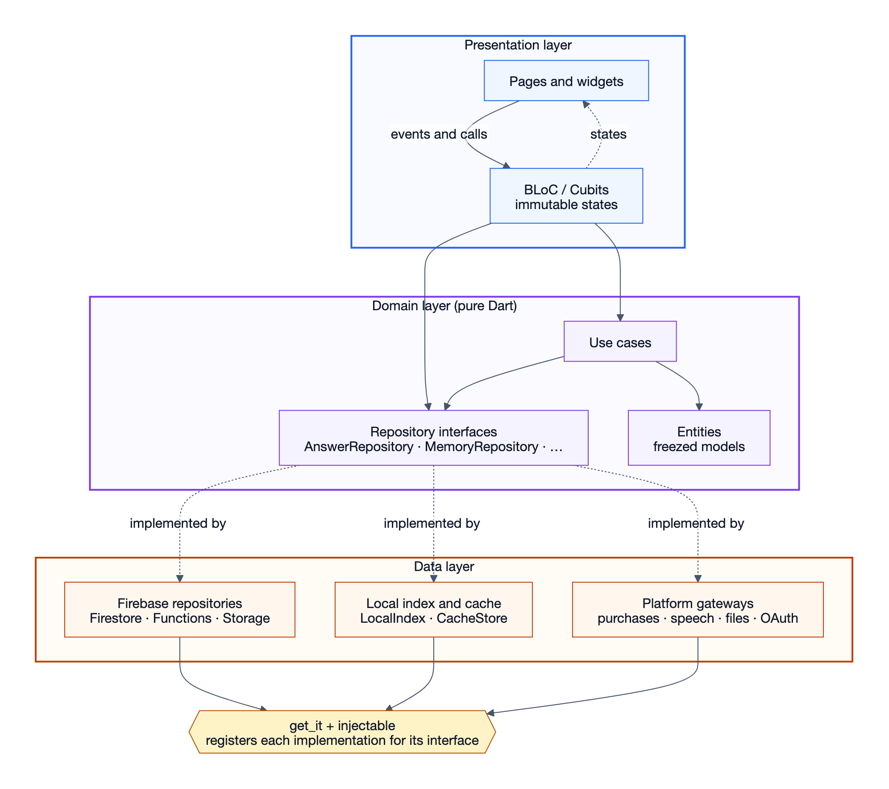

*Figure 13: Flutter app layered architecture.*

**How to read it.** Read top to bottom: the three bands are the layers.
Solid arrows are calls, and they only point **downward**: widgets call BLoCs,
and BLoCs call use cases and repository interfaces. The dotted "implemented by"
arrows show the dependency inversion: the domain layer defines the interfaces
and the data layer supplies the implementations. At the bottom, get_it +
injectable decides which implementation each interface gets at runtime. That's
why `AnswerRepository` can be `LocalAnswerRepository` (on-device search) in
production and a fake in tests, with no change to any screen.

### 15.2 Feature modules

| Feature | Responsibility | Notable pieces |
| --- | --- | --- |
| `auth` | Sign-in, email code, onboarding ("how you ask": voice or typing) | `SessionCubit`, `EmailSignInCubit`, `SocialAuthGateway` |
| `capture` | Camera, scanner, files, links, voice notes, upload queue | `UploadCenter` (app-wide job queue, offline pause/resume), `UploadIntake` (size → type → SHA-256 → duplicate check) |
| `memory` | Library, filters, file viewer, audio playback | `MemoryListBloc`, `PendingRemovals` (5-second undo before delete) |
| `chat` | Search and ask, on-device index | `LocalIndex`, `IndexSync`, `ranking.dart`, `local_query.dart`, `AnswerCubit` |
| `voice` | Orb home screen, dictation, result stack | `VoiceCubit` (prefetches results 700 ms after speech settles) |
| `connectors` | Drive connect, permissions, folder choice, progress | `ConnectStorageCubit`, `IndexProgressCubit` (streams `indexJobs`) |
| `billing` | Paywall, plans, purchases, limits | `LivePlan` (listens to the ledger), `PurchaseGateway` |
| `account` | Profile, vault overview, delete / deactivate | `ProfileCubit`, `VaultCubit` |

### 15.3 Cross-cutting pieces (`core/`)

- **Composition root** (`bootstrap.dart`): initialise Firebase → DI → error
  handlers → `runApp`. Order matters, so no error can happen before a
  reporter is attached.
- **Config via `--dart-define-from-file`**: OAuth client IDs and the Sentry
  DSN are compiled in per environment (`config/dev.json`, `prod.json`).
- **Errors**: `AppException` plus an error mapper turn Firebase and function
  errors into user-facing messages and retry decisions.
- **Feedback system**: a central snackbar controller for upload progress,
  undo, offline and sync news.
- **Lenient enums**: unknown values from a newer backend degrade to a default
  (for example `MemoryType.file`) instead of crashing. Either side can deploy
  first.

### 15.4 UI and visual design

- A **dark-only design system (v3)**, with palette, spacing and typography
  tokens.
- The home screen's **"eye orb"** is drawn by a custom **GLSL fragment
  shader** (`shaders/eye_orb.frag`) that reacts to voice phases (ready,
  listening, retrieving, answered).
- Motion design and the launch film were built in Blender.
- **Golden tests** (screenshot comparisons) guard the key screens against
  visual regressions.

---

## 16. Landing website

| Aspect | Choice |
| --- | --- |
| Framework | React 19 + TypeScript, built with Vite |
| Rendering | Client build **plus SSR build + prerender script** → static HTML for fast first paint and SEO |
| Styling | CSS Modules, self-hosted fonts |
| Hosting | Vercel, with security headers (nosniff, Referrer-Policy, …) |
| Pages | Home (hero film, pain points, story sections), install, privacy, terms, delete-account (needed for app-store compliance) |

---

## 17. Performance, cost and testing

### 17.1 Measured latency and optimisations

Measured from production logs. Each search logs one line with per-stage
timings.

| Stage | Before | After |
| --- | --- | --- |
| Warm server search | 450–650 ms | — |
| Plan / usage read inside search | 100–300 ms | **Removed** (search is not metered) |
| Memory title lookup | 30–170 ms | **2-minute in-memory cache** (`meta_cache`) |
| Cold start (first request after idle) | +2.5 to 4 s (once 8 s) | **1 warm instance kept for `ask`** (about $7 per month) |
| HTTP client to Gemini | New client per request | One pooled client per instance |
| Voice query | Search starts after speech ends | **Prefetch** while the user is still speaking |
| Search itself | Server round-trip | **On-device**. Only the query embedding uses the network. |

A lesson recorded in the code: **the biggest cost was invisible in the stage
timings**. A cold start happens before the timer starts, so it was found by
comparing the log timestamp with the "starting new instance" event.

### 17.2 Model selection (cost vs quality)

| Job | Model | Reason |
| --- | --- | --- |
| Embeddings | `gemini-embedding-001` | Cheap (about $0.20 per million tokens), one-time per chunk |
| Answers | `gemini-3.1-flash-lite` | Same cited answers and refusals as 3.5 Flash-Lite in tests, about 25% cheaper |
| Reading files | `gemini-3.6-flash` | Runs once per file, so quality matters more than price |
| Free-tier reading | `gemini-3.1-flash-lite` | Twice as fast, less detail, much cheaper |

Model IDs are **probed, not assumed**. Scripts (`probe_models.py`,
`probe_burst.py`) test which model IDs the API key can call and how many
calls a burst sustains before rate limits. A fallback ladder means a retired
model ID degrades to the next model instead of failing.

### 17.3 Testing strategy

| Level | Tools | Examples |
| --- | --- | --- |
| Backend unit tests (~350) | `pytest` | Chunking edge cases, date parsing, RRF ranking, ledger arithmetic, retention decisions, SSRF guards, email-code limits |
| Security rules | `test_security_rules.py` | Clients can't write server-owned fields |
| Deploy safety | `test_main_exports.py`, `test_module_surface.py` | Every function is exported from `main.py`, so nothing is silently left out of a deploy |
| App unit / BLoC tests | `flutter_test`, `bloc_test`, `mocktail`, `fake_async` | Cubit state sequences, sync logic, local ranking |
| Widget tests | `flutter_test` | Screens render, taps navigate, no unsafe `pop()` on tab roots |
| Visual regression | 29 golden images | Pixel comparison of key screens |
| Static analysis | `flutter analyze`, `ruff` | Lint and type checks |
| Manual QA | `docs/QA_CHECKLIST.md`, `docs/QA_FINDINGS.md` | Real-device runs on Android and iOS |

Good design choices that made testing easy: **pure logic kept separate from
I/O**. `usage.Ledger`, `retention.decide` and `retrieval`'s ranking touch no
database, so they are tested directly. Interfaces (`ChunkFeed`, `Embedder`)
let the sync engine run in tests without Firestore.

### 17.4 Deployment

- **Backend:** `firebase deploy --only firestore:rules,firestore:indexes,functions`.
  Functions run in `us-central1`. Secrets (Gemini key, auth-code secret,
  connector key, email keys) live in Secret Manager.
- **Android:** package `in.hawkapp.app`, Play App Signing, uploaded to a
  closed test track.
- **iOS:** bundle `in.hawkapp.app`. Dependencies use Swift Package Manager.
- **Website:** Vercel.
- **Local development:** Firebase emulators (`make emulate`) plus
  `make run`.

---

## 18. Challenges faced and how they were solved

These make a strong "Implementation challenges" chapter. Each one is real and
was diagnosed from logs or measurements.

| # | Problem (symptom) | Root cause | Solution |
| --- | --- | --- | --- |
| 18.1 | Searches were slow, and a third of them got no filters | An LLM call parsed dates and types: 1.5–4.2 s, and 1 in 3 calls failed | Replaced with a deterministic rule-based parser (microseconds, never fails) |
| 18.2 | Firestore has only vector search, no keyword index or reranker | Platform limitation | Over-fetch 60 by vector, lexical rescore, fuse with **RRF** |
| 18.3 | Date filters couldn't combine with vector search | Firestore disallows range filters alongside KNN | Type is a pre-filter; date is a post-filter over the over-fetched set |
| 18.4 | "garden image" found nothing | Photos were only *transcribed*, and a photo with no text produced zero chunks | Image-specific "describe what it shows + any text" prompt |
| 18.5 | Every embedding batch for one user returned HTTP 400; their index never became ready | A **Hindi** paragraph never split: the sentence regex required a Latin capital letter after a full stop. One 4,193-character chunk exceeded the 4,000-character limit and failed the whole batch. | Over-long units are sliced into overlap-sized pieces; the server truncates instead of rejecting; the phone skips blank chunks and clamps length |
| 18.6 | Tried to shrink KNN responses by projecting fields | Firestore **drops the distance** field when a vector query is projected (seen in production logs) | Reverted; the transfer cost ends anyway once vectors move to phones |
| 18.7 | First search of a session took 3–10 s | Functions scaled to zero, so every session began with a cold start | 1 warm instance on `ask`; metadata cache; pooled HTTP client; prefetch while speaking |
| 18.8 | Deleted files kept appearing as sources | Deleting a memory didn't delete its chunks | Delete cascades via trigger; **soft-delete tombstones** so phones see removals; periodic full reconcile |
| 18.9 | Free users' memories never expired | Nothing ever read `recallExpiresAt` on a schedule | Daily sweep + plan-change trigger + pure `decide()` rule |
| 18.10 | Bursts of captures failed with HTTP 429 | Model rate limits | Retries with exponential back-off honouring `Retry-After`, then a fallback model; memory records `readWith` for a later re-read |
| 18.11 | A deploy left every function returning 403 | A blocking auth trigger needs Identity Platform; its failed registration aborted the deploy before access permissions were applied | Trigger removed; profile creation done by an idempotent `ensure_profile` callable |
| 18.12 | Two simultaneous questions could both use the last answer | Check-then-count race | Transactional **reserve → answer → release** |
| 18.13 | A client could reset its weekly cap by changing its time zone | Week end recomputed per request | `weekEndsAt` recorded once at the week's first answer |
| 18.14 | Older model IDs suddenly returned 404 | Provider retired them for new projects | Probe scripts plus a fallback ladder that remembers refused IDs |
| 18.15 | New functions existed in code but never reached production | Firebase discovers functions only from `main.py` exports | `test_main_exports.py` fails the build if a function isn't exported |

---

## 19. Limitations and future work

| Area | Current state | Future work |
| --- | --- | --- |
| Intelligent Storage Engine | Designed in the spec (duplicate / stale detection, "Can I delete this?", archive-before-delete, storage dashboard). **Not yet built.** | Score files by importance, recency and whether they were ever recalled; recommend archiving, never delete silently |
| Personal knowledge graph | `topics` and `entities` collections are reserved in the rules but not populated | Extract people, places and topics; relationship search |
| Keyword search | Lexical *rescoring* of vector candidates only | A real lexical index (for example BM25) as a second retriever. The RRF step already accepts it unchanged. |
| Embeddings | Computed by a cloud model, stored on the phone | Fully on-device embedding model. The `Embedder` interface is ready. |
| Connectors | Google Drive and the phone | OneDrive, Dropbox, iCloud. The connector contract is ready. |
| Video | Kept but not searchable | Strip the audio track → transcribe |
| Old text-less photos | Can't be re-read server-side (upload was discarded) | "Re-read from phone" action |
| Link fetching | DNS rebinding gap documented | Pin the connection to the checked IP address |
| Cloud vector indexes | Still declared for the server fallback path | Drop them once every device has built its local index |

---

## 20. Conclusion

Hawk shows that a **trustworthy personal AI memory** can be built on a small
serverless stack. Three ideas carry the design:

1. **The database enforces the rules.** Multi-tenant isolation, server-owned
   fields and read-only indexes live in Firestore security rules, so a client
   bug or a tampered app fails closed.
2. **Answers are grounded by code, not by prompt.** Retrieval is hybrid and
   fused by rank. Citations are validated after generation, and the system
   refuses to answer when nothing relevant was found.
3. **The phone is part of the architecture.** Keeping vectors and retrieval on
   the device improves privacy, removes search from the metered cost, and cuts
   latency. The cloud keeps only the text needed to generate and cite answers.

The project also shows an engineering discipline worth noting in the report:
decisions were made from **measurements** (latency logs, model probes, cost
per answer), and every failure found in production became a regression test.

---

## 21. Suggested report chapter mapping

| Report chapter | Use these sections |
| --- | --- |
| Abstract | 1 |
| 1. Introduction (background, problem, motivation) | 2, 4 |
| 2. Objectives and scope | 3, 19 (what is out of scope) |
| 3. Literature survey / existing systems | 2 (comparison table), 23 (RAG, RRF, Matryoshka embeddings) |
| 4. System analysis (requirements, feasibility) | 3, 5, 14.1 (plans), 17.2 (cost) |
| 5. System design (architecture, DFD, ER, sequence diagrams) | 4 (Fig. 1), 6, 7, 8.1, 9.2, 10.2, 11.2, 12, 13.2, 15.1 (Figs. 2–13) |
| 6. Implementation (modules, algorithms) | 6.4, 8, 9, 10, 11, 13, 14, 15 |
| 7. Security | 12 |
| 8. Testing | 17.3 |
| 9. Results and performance | 17.1, 17.2 |
| 10. Challenges | 18 |
| 11. Conclusion and future scope | 19, 20 |
| References | 23 |

**List of figures** (files in `diagrams/`):

| Figure | Title | UML / report type | File |
| --- | --- | --- | --- |
| 1 | Use-case diagram | Use case | `01-use-case.png` |
| 2 | Context diagram | DFD level 0 | `02-context-dfd.png` |
| 3 | System architecture | Architecture / deployment | `03-system-architecture.png` |
| 4 | Entity-relationship diagram | ER | `04-er-diagram.png` |
| 5 | Memory processing states | State chart | `05-memory-states.png` |
| 6 | Ingestion pipeline | Activity / flowchart | `06-ingestion-pipeline.png` |
| 7 | Hybrid retrieval funnel | Activity / flowchart | `07-retrieval-funnel.png` |
| 8 | Asking a question | Sequence | `08-ask-sequence.png` |
| 9 | On-device index sync | Sequence | `09-on-device-sync.png` |
| 10 | Email-code sign-in | Sequence | `10-email-sign-in.png` |
| 11 | Connecting Google Drive (PKCE) | Sequence | `11-oauth-pkce.png` |
| 12 | Rolling answer window | Timeline (Gantt) | `12-answer-window.png` |
| 13 | Flutter layered architecture | Component / layer | `13-flutter-layers.png` |

---

## 22. Glossary

| Term | Meaning |
| --- | --- |
| **Memory** | One saved item after the system has understood it (title, type, status, extracted text) |
| **Chunk** | A ~1000-character overlapping passage of a memory's text. The unit of search and citation. |
| **Embedding** | A list of numbers (here 1536) representing meaning. Similar meanings give nearby vectors. |
| **Cosine distance** | How far apart two vectors point: 0 = identical, 2 = opposite |
| **KNN** | k-nearest-neighbour search: find the vectors closest to the query vector |
| **RAG** | Retrieval-Augmented Generation: retrieve relevant passages, then have a language model answer *only* from them |
| **RRF** | Reciprocal Rank Fusion: merge several rankings by summing 1/(k + rank) |
| **Matryoshka embedding** | An embedding whose leading dimensions are themselves a usable smaller embedding, so it can be truncated |
| **Security rules** | Firestore's server-side access-control language, checked on every read and write |
| **Callable function** | A Cloud Function the app invokes by name, with the user's auth attached automatically |
| **Trigger** | A Cloud Function that runs automatically when a document is created, changed or deleted |
| **PKCE** | Proof Key for Code Exchange: an OAuth extension that binds the authorisation code to a secret verifier |
| **SSRF** | Server-Side Request Forgery: tricking a server into fetching internal addresses |
| **Tombstone** | A "deleted" marker kept for a while so other devices learn about the deletion |
| **Dormant** | A memory outside the plan's window: kept, visible, but not used for search or answers |
| **BLoC / Cubit** | Flutter state-management pattern: events or methods in, immutable states out |
| **Golden test** | A test that compares a rendered screen to a saved reference image |
| **Cold start** | Delay when a serverless function must start a new instance before handling a request |

---

## 23. References

1. P. Lewis et al., "Retrieval-Augmented Generation for Knowledge-Intensive
   NLP Tasks," *NeurIPS*, 2020.
2. G. V. Cormack, C. L. A. Clarke, S. Büttcher, "Reciprocal Rank Fusion
   Outperforms Condorcet and Individual Rank Learning Methods," *SIGIR*, 2009.
3. A. Kusupati et al., "Matryoshka Representation Learning," *NeurIPS*, 2022.
4. N. Sakimura, J. Bradley, N. Agarwal, "Proof Key for Code Exchange by OAuth
   Public Clients," RFC 7636, IETF, 2015.
5. OWASP Foundation, "Server-Side Request Forgery Prevention Cheat Sheet."
6. Google, *Firebase documentation*: Cloud Firestore security rules, vector
   search, Cloud Functions for Firebase (Python).
7. Google, *Gemini API documentation*: embeddings (task types, output
   dimensionality), multimodal file input.
8. Flutter team, *Flutter documentation*; F. Angelov, *bloc library
   documentation*.
9. Google Play, *Real-time developer notifications* and *Subscriptions API*
   documentation.

---

## 24. Appendix: key numbers at a glance

| Parameter | Value | Where |
| --- | --- | --- |
| Chunk target / overlap / minimum | 1000 / 150 / 60 characters | `chunking.py` |
| Max chunks per memory | 400 | `ingestion.py` |
| Embedding dimensions | 1536 (from 3072, re-normalised) | `gemini.py` |
| Vector candidates / context passages | 60 / 8 | `retrieval.py`, `ranking.dart` |
| RRF constant k | 60 | `retrieval.py` |
| Weak-match distance (caps confidence) | 0.62 | `rag.py` |
| Embed batch size / max characters | 50 texts / 8,000 characters | `local_index.py`, `embedder.dart` |
| Upload limit | 100 MB | `storage.rules` |
| Link fetch limits | 2 MB body, 5 redirects, 10 s | `link_archive.py` |
| Email code | 6 digits, 10 min TTL, 5 attempts, 5/hour | `email_codes.py` |
| Answer window | 2 hours, per-answer renewal | `billing.py`, `usage.py` |
| Answers (window / week) | Free 2/20 · Standard 10/150 · Premium 25/400 | `billing.py` |
| Tombstone lifetime | 30 days | `chunk_store.py` |
| Delta sync overlap / full reconcile | 10 min / every 7 days | `index_sync.dart` |
| Ingestion function | 1 GB RAM, 540 s timeout, ≤20 instances | `ingestion.py` |
| Warm instances | 1 (`ask` only) | `api.py` |
| Deployed Cloud Functions | 38 | `main.py` |
